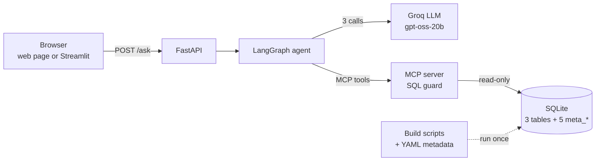
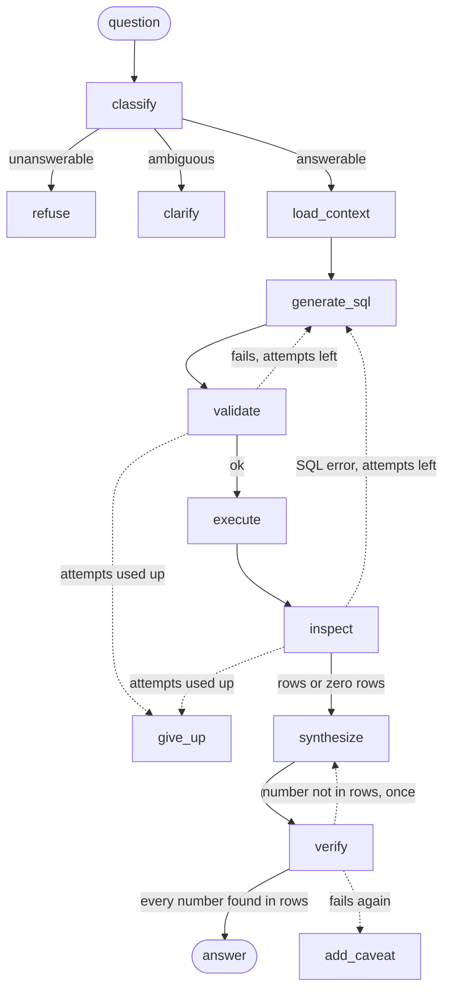

# AskAuto

**Ask a car dealer group's sales database questions in plain English, and get answers
that show their work.**

AskAuto turns a question like *"What was our net revenue last year?"* into SQL, runs it
safely, and answers in plain English, returning the **SQL and the rows behind every
number** so anyone can check it. It refuses questions the data can't answer, asks for
clarification when a question is vague, and verifies that every figure in its answer
really came from the data.

```text
Q: What was our net revenue last year?
A: Net revenue for 2025 was $52.2M, calculated as sale price minus discount.

   SQL:          SELECT SUM(sale_price - discount_amount) AS net_revenue FROM sales
                 WHERE CAST(STRFTIME('%Y', sale_date) AS INTEGER) =
                       (SELECT CAST(STRFTIME('%Y', MAX(sale_date)) AS INTEGER) - 1 FROM sales)
   Assumptions:  last year = 2025; net revenue = SUM(sale_price - discount_amount)
   Rows:         [{"net_revenue": 52228431.6}]
   Trace:        classify → load_context → generate_sql → validate → execute → inspect
                 → synthesize → verify          (≈3 s)
```

---

## Why it's harder than "LLM writes SQL"

The database has two traps planted on purpose. Both give answers that **look right** and
raise **no error**:

| Trap | Naive SQL | What goes wrong | How AskAuto avoids it |
|---|---|---|---|
| Gross vs net | `SUM(sale_price)` | $54.1M, 3.5% too high | A business glossary maps "revenue" to `SUM(sale_price - discount_amount)`, every time |
| Category spelling | `region = 'North East'` | 0 rows, silently | Exact allowed values are in every prompt; a misspelling is caught before the query runs and retried |

Both fixes come from a **metadata catalogue** stored in the database and used to build
every prompt. Nothing about the schema is hard-coded.

---

## Architecture



| Component | Job | Tech |
|---|---|---|
| Web page / Streamlit | Thin clients that call the API | Plain HTML + JS · Streamlit |
| API | `POST /ask`, `GET /health`; starts everything once at startup | FastAPI, uvicorn |
| Agent | Classify, write SQL, validate, run, answer, verify, with retries | LangGraph, Pydantic state |
| LLM provider | Three calls behind one interface; strict JSON-schema output | Groq SDK (swappable) |
| MCP server | **The only runtime code that opens the database**; validates every query | MCP SDK 2.x, sqlglot, aiosqlite |
| Metadata | Descriptions, glossary, allowed values, known gaps | PRAGMA + hand-written YAML |

### The agent graph



The dotted edges, the ones that loop back, are the reason LangGraph is used.

### Safety: defence in depth

The LLM's SQL is treated as untrusted. In order:

1. Prompt rules: glossary expressions, exact allowed values, only listed tables
2. Agent-side check: sqlglot syntax-tree validation plus an allowed-value check, with retry
3. **Server-side guard in `run_sql`**: one `SELECT`/`WITH` statement, allowlisted tables
   and real columns only, `LIMIT` enforced. This layer assumes 1 and 2 were bypassed.
4. Read-only database connection
5. 5-second query timeout, 500-row cap
6. `verify`: every number in the answer must appear in the result rows

---

## Quick start

**Prerequisites:** Python 3.11+, a free [Groq](https://console.groq.com) API key.

```bash
# 1. Install (Windows paths shown; on macOS/Linux use .venv/bin/python)
python -m venv .venv
.venv/Scripts/python -m pip install -r requirements.txt
.venv/Scripts/python -m pip install -e . --no-deps

# 2. Configure: copy the template, then set GROQ_API_KEY in .env
cp .env.example .env

# 3. Build the database and metadata (seeded, so identical every time)
.venv/Scripts/python scripts/build_database.py
.venv/Scripts/python scripts/build_metadata.py

# 4. Run the API, then open http://localhost:8000/
.venv/Scripts/python -m uvicorn askauto.api:app --port 8000
```

Other ways in:

| What | Command / URL |
|---|---|
| Web page | http://localhost:8000/ (served by the API) |
| Interactive API docs | http://localhost:8000/docs |
| Streamlit UI (optional) | `.venv/Scripts/python -m streamlit run frontend/streamlit_app.py` → http://localhost:8501 |
| One question from the terminal | `.venv/Scripts/python -m askauto.agent "Which three dealers had the highest net revenue in 2025?"` |
| curl | `curl -s -X POST http://localhost:8000/ask -H "Content-Type: application/json" -d '{"question": "What was our net revenue last year?"}'` |
| Check the MCP server by hand | `.venv/Scripts/python -m askauto.mcp_server.probe` |
| Check the Groq key | `.venv/Scripts/python -m askauto.providers.smoke` |

### Questions to try

| Kind | Question |
|---|---|
| Revenue | *What was net revenue by region in 2025?* |
| Ranking | *Which three dealers had the highest net revenue in 2025?* |
| Mix | *What was the EV share of units sold in 2025?* |
| Trap 1 | *What was our total revenue in 2025?* → net, not gross |
| Trap 2 | *How many cars did the North East region sell in 2024?* → `'Northeast'` |
| Refusal | *What is the average credit score of our buyers?* |
| Clarification | *Which dealer is the best?* |

> The free Groq tier allows about 8K tokens a minute, roughly 1.5 questions a minute.
> Asking faster still works, but answers slow down while the provider waits out the limit.

---

## API

`POST /ask`

```json
// request
{"question": "What was our net revenue last year?"}

// response
{
  "answer": "Net revenue for 2025 was $52.2M ...",
  "sql": "SELECT SUM(sale_price - discount_amount) ... LIMIT 500",
  "assumptions": ["last year = 2025", "net revenue = SUM(sale_price - discount_amount)"],
  "rows": [{"net_revenue": 52228431.6}],
  "trace": ["classify: answerable - ...", "load_context: ...", "..."],
  "latency_ms": 2917,
  "status": "answered"
}
```

`status` is `answered`, `refused`, `clarification_needed`, `failed` or `unverified`.
`sql` and `rows` are empty when no query ran (refusals, clarifications).
Errors return JSON: 422 (bad request), 502 (LLM provider), 503 (data service).

`GET /health` checks the MCP server with a real round trip and returns the model and the
tables.

---

## Results

**Tests:** 158 passing, no network, about 20 s (`.venv/Scripts/python -m pytest -q`).
The LLM is mocked in every test; each retry and refusal path is forced to run at least once.

**Golden evaluation set:** 25 questions (lookups, aggregations, joins, both traps,
refusals, clarifications). Each answerable one has reference SQL, and its expected values
come from running that SQL, never from typing them in.

| Metric | Latest full run | Target |
|---|---|---|
| Accuracy | **24/25 (96%)** | 25/25 |
| SQL validity | **100%** (100% first attempt) | 100% |
| Latency | p50 **2.4 s**, p95 **3.3 s** | p95 < 8 s |

The one miss, *"How many F150s have we sold?"*, was the classifier asking for a time
period. It's fixed with a general rule (no time period means all data, stated as an
assumption) and verified on a targeted re-run alongside both clarification questions.
A fresh full run will confirm 25/25:

```bash
.venv/Scripts/python evals/run_evals.py        # paced for the rate limit, ~20 min
```

---

## Project layout

```text
scripts/            build time only: database + metadata (may open the DB directly)
metadata/           hand-written YAML: descriptions, glossary, known gaps
src/askauto/
  config.py         settings (pydantic-settings, .env)
  mcp_server/       the ONLY runtime database access: SQL guard, tools, read-only DB
  mcp_client.py     typed client used by the agent and the API
  providers/        LLM interface + Groq implementation (the only Groq import)
  agent/            state, prompts, nodes, graph, literal check, verify
  api.py            FastAPI app
  web/index.html    plain web page served at /
frontend/           Streamlit client (separate process)
evals/              25 golden questions, runner, saved scorecards
tests/              unit + integration tests
docs/               spec, architecture, progress log, notebooks
```

---

## Documentation

| Document | What's in it |
|---|---|
| [docs/INTERVIEW_GUIDE.ipynb](docs/INTERVIEW_GUIDE.ipynb) | Plain-English explanation: pitch, diagrams, design decisions and trade-offs, lessons, Q&A |
| [docs/CODE_WALKTHROUGH.ipynb](docs/CODE_WALKTHROUGH.ipynb) | The code in reading order with runnable cells, ending with one question traced through every function |
| [docs/PROBLEM_STATEMENT.md](docs/PROBLEM_STATEMENT.md) | The spec, and the source of truth |
| [docs/ARCHITECTURE.md](docs/ARCHITECTURE.md) | Component boundaries and the graph |
| [docs/PROGRESS.md](docs/PROGRESS.md) | Build log: every decision, deviation, scorecard and verified command |

---

## Key design decisions

| Decision | Why |
|---|---|
| Prompts built from `meta_*` tables | The traps can only be beaten by knowing what columns *mean*, defined once and used identically |
| MCP server as the only database access | The guard can't be bypassed; the data layer is testable alone; swapping databases touches one module |
| Validation on the parsed syntax tree, not regex | You know exactly what the query does |
| Three separate LLM calls | Each has one job and its own settings (temperature 0 for SQL, 0.4 for prose) |
| Structured output everywhere | Every LLM call returns a validated Pydantic object; no free text is parsed |
| No vector database (yet) | The whole data description is about 2.1K tokens and fits in one prompt |
| Seeded synthetic data | Every answer is known in advance, so tests and evals are exact |

**Limitations:** single-turn (no follow-up questions); free-tier rate limit; `verify`
checks numbers, not claims like "highest"; no authentication or audit log (out of scope).

**Roadmap:** vector schema retrieval for many tables (a change inside the MCP server only),
a library of worked SQL examples, and a free-text column with a supervisor plus
specialist agents.

---

## Tech stack

Python 3.12 · LangGraph · MCP Python SDK 2.x · FastAPI · Pydantic · sqlglot · aiosqlite ·
SQLite · Groq (`openai/gpt-oss-20b`) · Streamlit · pytest · ruff

Built stage by stage with [Claude Code](https://claude.com/claude-code), using
`CLAUDE.md` for project rules, path-scoped rules, skills, and a hook that blocks database
or Groq imports in the wrong layer. See [docs/PROGRESS.md](docs/PROGRESS.md) for the
full build log.
